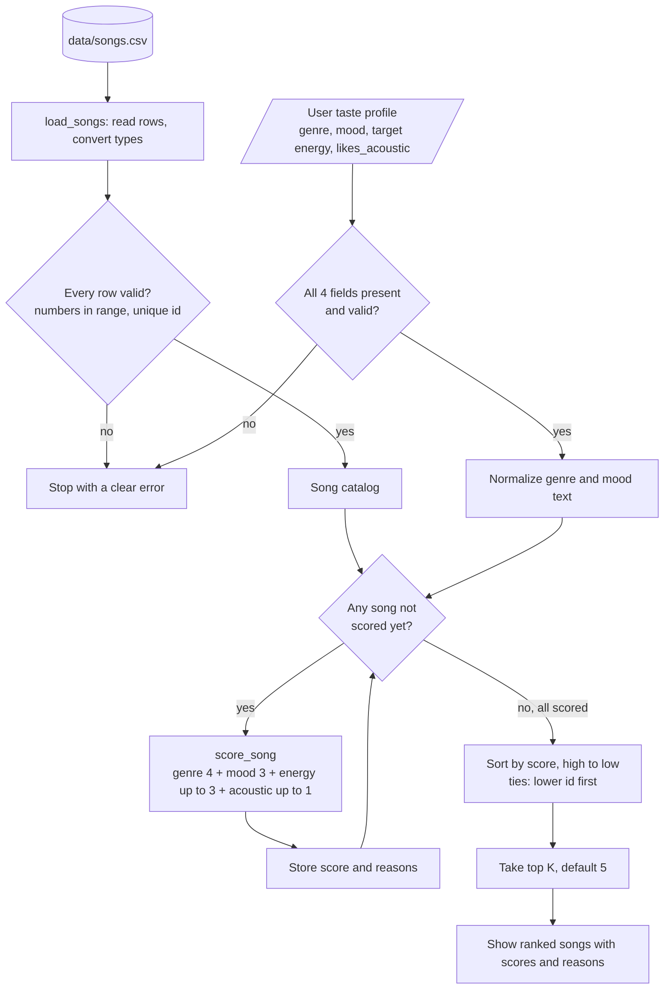

# 🎵 Music Recommender Simulation

## Project Summary

In this project you will build and explain a small music recommender system.

Your goal is to:

- Represent songs and a user "taste profile" as data
- Design a scoring rule that turns that data into recommendations
- Evaluate what your system gets right and wrong
- Reflect on how this mirrors real world AI recommenders

Replace this paragraph with your own summary of what your version does.

---

## How The System Works

### How real platforms do it (and what I'm doing instead)

Services like Spotify and YouTube combine many signals instead of relying on one formula. They look at **behavior** (what you play, skip, save, search for, share, or how long you watch), at **other users** (collaborative filtering: "people whose history looks like yours also liked this"), and at **the content itself** (genre, release date, audio characteristics). Spotify also mixes in human editors who pick a pool of candidate tracks that an algorithm then personalizes and orders for each listener.

This project has no listening history and no other users. It has 18 songs with descriptive attributes (the starter's 10 plus 8 fictional songs I added to cover more genres and moods) and one user who says what they like. That makes **content-based filtering** the right fit: compare each song's attributes with the user's stated preferences. The recommender will be a deterministic, hand-weighted scoring rule rather than a trained model, so every score can be traced back to the exact features that produced it.

### What a `Song` stores

Each row of `data/songs.csv` becomes a `Song` with:

- **Identity / metadata:** `id`, `title`, `artist`. These are used for display and tie-breaking, not scoring.
- **Categorical features:** `genre` (13 labels) and `mood` (9 labels)
- **Numeric features (0–1 scale):** `energy` (0.14–0.93 in this catalog), `valence`, `danceability`, `acousticness` (0.05–0.98)
- **Numeric feature (BPM):** `tempo_bpm` (60–152)

Only `genre`, `mood`, `energy`, and `acousticness` are used in the baseline score. The others stay in the data for later experiments.

### What a `UserProfile` stores

A user describes their taste explicitly. No history is needed:

- `favorite_genre`: e.g. `"lofi"`
- `favorite_mood`: e.g. `"chill"`
- `target_energy`: a number from 0 to 1 for how energetic they want the music to be
- `likes_acoustic`: `True` or `False`

These four names are also the exact keys the dictionary-based functions will expect, so a profile looks the same whether it's a `UserProfile` object or a plain dict.

### Example User Profiles

These are simulated personas I'll use to design and test the recommender. They aren't anyone's real listening data.

**Primary profile: chill lofi listener**

```python
{
    "favorite_genre": "lofi",    # the style they want most
    "favorite_mood": "chill",    # the feeling they're looking for
    "target_energy": 0.40,       # moderate-to-low intensity (0 = calm, 1 = intense)
    "likes_acoustic": True,      # prefers organic/acoustic sound over heavily produced tracks
}
```

This profile should clearly separate a song like *Library Rain* (lofi, chill, energy 0.35, very acoustic) from *Storm Runner* (rock, intense, energy 0.91, barely acoustic), because they differ on all four fields. It can also tell lofi songs apart from each other. *Focus Flow* is lofi but `focused` rather than `chill`, so it should land below the two chill lofi tracks.

**Contrasting profile: intense rock listener**

`favorite_genre="rock"`, `favorite_mood="intense"`, `target_energy=0.90`, `likes_acoustic=False`. This is the opposite end of the catalog. The rock/intense songs should rise to the top, and the quiet acoustic tracks that suit the lofi listener should sink to the bottom. Comparing the two lists will be a quick sanity check that the scoring actually responds to preferences.

One limitation is that each profile has only *one* favorite genre and mood. A listener who likes both lofi and jazz, or who is happy with "relaxed" as well as "chill", can't express that yet.

### Algorithm Recipe (finalized design, not yet implemented)

> **Status:** this is the plan for Phase 3. `score_song`, `recommend_songs`, and `Recommender` are still starter stubs, so every number in this section was calculated by hand from `data/songs.csv`. None of it is program output.

Every song is scored against the user on four features. Before genre and mood are compared, the text on both sides is normalized: trim the ends, collapse repeated spaces, and lowercase. That way `" Indie  Pop "` matches `"indie pop"`.

| Feature | Max points | Rule |
|---|---|---|
| Genre | 4.0 | +4 if the normalized `genre` equals the normalized `favorite_genre`, else 0 |
| Mood | 3.0 | +3 if the normalized `mood` equals the normalized `favorite_mood`, else 0 |
| Energy | 3.0 | `3 × max(0, 1 − abs(song.energy − target_energy))` |
| Acoustic fit | 1.0 | `acousticness` if `likes_acoustic` is `True`, else `1 − acousticness` |
| **Total** | **11.0** | |

- **Labels outweigh numbers.** Genre and mood are worth 7 points together, while perfect energy and acoustic fit add up to 4. A song that matches neither label can score at most 4.0, and 4.0 is the *lowest* score any genre match can get. Numeric closeness can reorder songs, but it can never push a different-genre song above a same-genre song by itself.
- **Genre (4) sits just above mood (3).** Genre reflects long-term taste, and mood is more situational. The gap is only one point, so a song that matches the mood and fits the numbers very well can catch up with a song that only matches the genre (see the rock example below).
- **Energy rewards closeness, not intensity.** For a target of 0.40, a 0.42 song earns 2.94 points and a 0.91 song earns 1.47. The closer song always scores higher. Energies and targets are both on a 0–1 scale, so the `max(0, …)` is only a safety guard.
- **`likes_acoustic=False` means "prefers a produced sound," not "rejects acoustic songs."** It never subtracts points. A very acoustic song just earns close to 0 of the 1 available point. Profiles must state this field explicitly as a real `True` or `False`.
- **Not in the baseline:** `valence`, `danceability`, and `tempo_bpm` are kept as Phase 4 experiments.

#### Why this weighting

I compared three weightings by hand against all 18 songs for both example profiles:

| Strategy | Genre / mood / energy / acoustic | Lofi/chill: places 3–4 | Rock/intense: places 3–4 |
|---|---|---|---|
| A: simple baseline | 2 / 1 / up to 2 / not used | Focus Flow (4.00), Spacewalk Thoughts (2.76) | Static Postcards (3.44), Gym Hero (2.94) |
| **B: chosen** | **4 / 3 / up to 3 / up to 1** | Focus Flow (7.78), Spacewalk Thoughts (6.56) | Gym Hero and Static Postcards, **tied at 6.86** |
| C: mood-focused | 2 / 4 / up to 3 / up to 1 | Spacewalk Thoughts (7.56), Focus Flow (5.78) | Gym Hero (7.86), Static Postcards (4.86) |

All three put the same two songs at the top for each profile: the two chill lofi tracks, and *Storm Runner* and *Breakwater*. They only disagree about whether a same-genre song with the wrong mood should beat a same-mood song from another genre. Strategy A never uses `likes_acoustic`, so one of the four profile fields would do nothing. C is the most open to cross-genre discovery, but it lets mood outweigh the listener's stated genre by two points. B uses every field, keeps genre slightly ahead, and still lets a strong cross-genre match compete, so it stays the baseline. C is a good Phase 4 experiment.

### Ranking Rule

1. Take one user profile and the full song catalog.
2. Score every song on genre, mood, energy, and acoustic fit.
3. Add the four parts into one relevance score.
4. Keep a short reason for each part, e.g. `"genre match: lofi (+4.00)"`.
5. Sort by score, highest first.
6. When scores tie, put the lower `id` first.
7. Return the top `k` songs (default 5) with their scores and reasons.

Scoring and ranking are separate jobs. Scoring answers "how well does *this one* song fit?" and never looks at other songs. Ranking answers "which songs are best overall?" Because they're separate, the formula can be unit-tested on a single song, and the ranking can change later (for example, a limit on songs per artist) without touching the math.

**Deterministic and reproducible.** There's no randomness, clock, or learned state, so the same CSV and profile always produce the same list. The planned sort key is `(-round(score, 6), id)`. The rounding is deliberate. Some songs tie exactly on paper (*Gym Hero* and *Static Postcards* both score 6.86 for the rock profile), and rounding makes sure that a tiny floating-point error never decides a tie that should go to the lower `id`.

**Edge cases (planned behavior for Phase 3):**

| Case | Planned behavior |
|---|---|
| Empty catalog | Return `[]` |
| `k = 0` | Return `[]` |
| `k` larger than the catalog | Return every song, ranked |
| Negative `k` | Raise `ValueError`, because Python slicing would quietly drop songs instead |
| Missing profile field | Raise `ValueError` naming the missing key, with no silent defaults |
| `target_energy` outside 0–1, or `likes_acoustic` not a real bool | Raise `ValueError`. The string `"False"` is truthy and would flip the preference. |
| Non-numeric or out-of-range CSV value, duplicate `id` | `load_songs` raises `ValueError` with the row and column |
| Equal scores | Lower `id` first |
| `"Lofi"`, `" lofi "`, `"LOFI"` | All match `"lofi"` after normalization |

### Scoring example (hand-calculated, not program output)

Lofi/chill profile: `favorite_genre="lofi"`, `favorite_mood="chill"`, `target_energy=0.40`, `likes_acoustic=True`.

| Song (genre, mood, energy, acousticness) | Genre | Mood | Energy | Acoustic | Total |
|---|---|---|---|---|---|
| #4 *Library Rain* (lofi, chill, 0.35, 0.86) | 4 | 3 | 3 × 0.95 = 2.85 | 0.86 | **10.71** |
| #2 *Midnight Coding* (lofi, chill, 0.42, 0.71) | 4 | 3 | 3 × 0.98 = 2.94 | 0.71 | **10.65** |
| #6 *Spacewalk Thoughts* (ambient, chill, 0.28, 0.92) | 0 | 3 | 3 × 0.88 = 2.64 | 0.92 | **6.56** |
| #3 *Storm Runner* (rock, intense, 0.91, 0.10) | 0 | 0 | 3 × 0.49 = 1.47 | 0.10 | **1.57** |

Two results are worth noticing. *Library Rain* edges out *Midnight Coding*, even though *Midnight Coding* is closer in energy, because the acoustic term (+0.15) outweighs the energy gap (−0.09). For the rock profile, *Gym Hero* (pop, intense: 0 + 3 + 2.91 + 0.95) ties *Static Postcards* (rock, moody: 4 + 0 + 2.16 + 0.70) at 6.86. Gym Hero lands third because of the `id` tie-break, not because it fits the listener better.

### Data flow



### Planned code structure

| Piece | Responsibility |
|---|---|
| `Song` | One catalog item: identity (`id`, `title`, `artist`) plus its features |
| `UserProfile` | The four preferences, with field names that match the dictionary keys |
| `load_songs(path)` | Read the CSV, convert types, validate ranges and unique IDs, and return a list of dicts |
| `score_song(user_prefs, song)` | **The only place the formula lives.** Returns `(score, reasons)` |
| `recommend_songs(user_prefs, songs, k=5)` | Score every song, rank them, and return `(song, score, explanation)` tuples |
| `Recommender.recommend(user, k=5)` | Object-oriented wrapper that converts the dataclasses with `asdict()`, calls `score_song`, and returns `Song` objects in ranked order |
| `Recommender.explain_recommendation(user, song)` | Joins the `reasons` from `score_song`, so the explanation can't disagree with the score |

The weights will be module-level constants. Text normalization and the sort-and-slice step will each be one small helper shared by both APIs. `UserProfile` field names are the canonical profile keys and `Song` field names are the CSV columns, so `asdict()` is the only bridge the object-oriented API needs. The existing tests should then pass for the right reason: their pop/happy test song scores 10.8, compared with 1.9 for the lofi one.

`src/main.py` needs three fixes in Phase 3. It should import with `from src.recommender import ...` so `python -m src.main` works, switch its example profile to the canonical keys (`favorite_genre`, `favorite_mood`, `target_energy`), and add `likes_acoustic`.

### Expected biases and limitations

Some problems are already visible in the data. Lofi and rock have three songs each and pop has two, but the other ten genres have one song each. A reggae or classical fan can get at most one genre match, while both example profiles happen to target the best-covered genres. Every highly acoustic song (acousticness ≥ 0.71) has energy ≤ 0.42, so there's nothing for someone who wants energetic acoustic music. One person assigned all the genre and mood labels, and those labels are subjective and culturally specific. Other problems are risks built into the algorithm. With 7 of 11 points on exact label matches, it leans toward a filter bubble and gives close neighbors no credit. For a chill listener, "relaxed" scores the same 0 as "sad," a pop fan gets nothing from "indie pop," and "hip hop" written without the hyphen would miss "hip-hop." One genre, one mood, and one energy target can't describe taste that changes with context, and the 1-point acoustic term can decide near-ties. Possible later fixes include partial credit for related genres and moods, multiple favorites, an artist or genre diversity rule, and genre aliases.

More detail on the Phase 1 research is in [docs/phase1_notes.md](docs/phase1_notes.md).

---

## Getting Started

### Setup

1. Create a virtual environment (optional but recommended):

   ```bash
   python -m venv .venv
   source .venv/bin/activate      # Mac or Linux
   .venv\Scripts\activate         # Windows

2. Install dependencies

```bash
pip install -r requirements.txt
```

3. Run the app:

```bash
python -m src.main
```

### Running Tests

Run the starter tests with:

```bash
pytest
```

You can add more tests in `tests/test_recommender.py`.

---

## Sample Recommendation Output

Paste a sample of your recommender's output here as a text block so a reader can see what it produces:

```
# e.g.:
# User profile: genre=indie, mood=chill, energy=low
# Recommendations:
#   1. ...
#   2. ...
#   3. ...
```

**Screenshot or video** *(optional)*: <!-- Insert a screenshot or demo video link here -->

---

## Experiments You Tried

Use this section to document the experiments you ran. For example:

- What happened when you changed the weight on genre from 2.0 to 0.5
- What happened when you added tempo or valence to the score
- How did your system behave for different types of users

---

## Limitations and Risks

Summarize some limitations of your recommender.

Examples:

- It only works on a tiny catalog
- It does not understand lyrics or language
- It might over favor one genre or mood

You will go deeper on this in your model card.

---

## Reflection

Read and complete `model_card.md`:

[**Model Card**](model_card.md)

Write 1 to 2 paragraphs here about what you learned:

- about how recommenders turn data into predictions
- about where bias or unfairness could show up in systems like this


