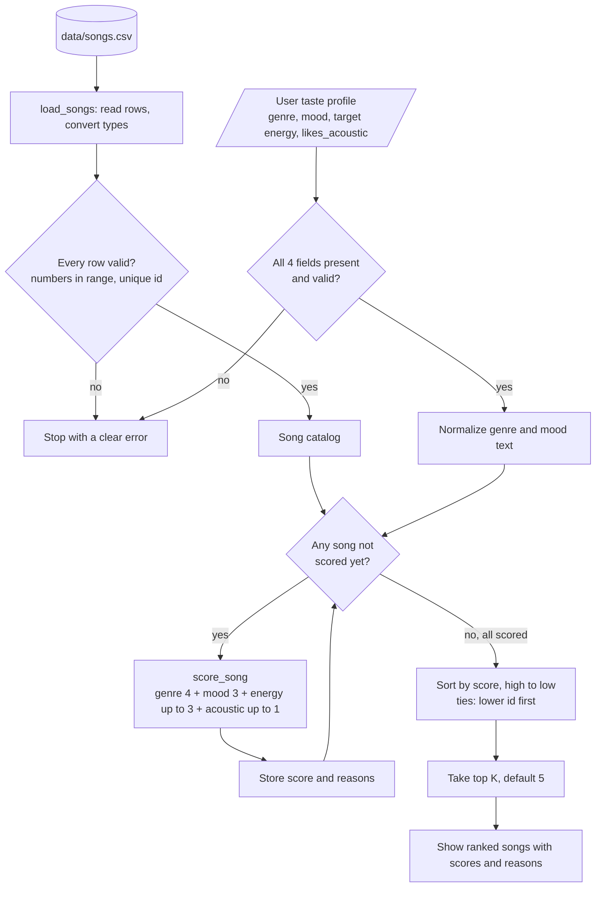

# 🎵 Music Recommender Simulation

## Project Summary

**VibeFinder 1.0** is a small, content-based music recommender written in Python. You give it a listener profile (favorite genre, favorite mood, target energy, and whether they like acoustic music), and it scores every song in an 18-song fictional catalog, ranks them, and prints the top five with an explanation of where each point came from.

There's no machine learning here. The score is a hand-weighted, deterministic rule (genre 4, mood 3, energy up to 3, acoustic fit up to 1), so every result can be traced back to the data. The project covers the design (Phases 1–2), implementation and tests (Phase 3), an evaluation with four test profiles and a weight experiment (Phase 4), and a [model card](model_card.md) and reflection (Phase 5).

---

## How The System Works

### How real platforms do it (and what I'm doing instead)

Services like Spotify and YouTube combine many signals instead of relying on one formula. They look at **behavior** (what you play, skip, save, search for, share, or how long you watch), at **other users** (collaborative filtering: "people whose history looks like yours also liked this"), and at **the content itself** (genre, release date, audio characteristics). Spotify also mixes in human editors who pick a pool of candidate tracks that an algorithm then personalizes and orders for each listener.

This project has no listening history and no other users. It has 18 songs with descriptive attributes (the starter's 10 plus 8 fictional songs I added to cover more genres and moods) and one user who says what they like. That makes **content-based filtering** the right fit: compare each song's attributes with the user's stated preferences. The recommender is a deterministic, hand-weighted scoring rule rather than a trained model, so every score can be traced back to the exact features that produced it.

### What a `Song` stores

Each row of `data/songs.csv` becomes a `Song` with:

- **Identity / metadata:** `id`, `title`, `artist`. These are used for display and tie-breaking, not scoring.
- **Categorical features:** `genre` (13 labels) and `mood` (9 labels)
- **Numeric features (0–1 scale):** `energy` (0.14–0.93 in this catalog), `valence`, `danceability`, `acousticness` (0.05–0.98)
- **Numeric feature (BPM):** `tempo_bpm` (60–152)

Only `genre`, `mood`, `energy`, and `acousticness` are used in the baseline score. The others stay in the data for later experiments.

The CSV also has five optional, synthetic columns (`popularity`, `release_decade`, `instrumentalness`, `vocal_intensity`, `mood_tags`). They're only used when advanced scoring is turned on (see [Advanced Features](#advanced-features)).

### What a `UserProfile` stores

A user describes their taste explicitly. No history is needed:

- `favorite_genre`: e.g. `"lofi"`
- `favorite_mood`: e.g. `"chill"`
- `target_energy`: a number from 0 to 1 for how energetic they want the music to be
- `likes_acoustic`: `True` or `False`

These four names are also the exact keys the dictionary-based functions expect, so a profile looks the same whether it's a `UserProfile` object or a plain dict.

### Example User Profiles

These are simulated personas I'll use to design and test the recommender. They aren't anyone's real listening data.

**Primary profile: chill lofi listener**

```python
{
    "favorite_genre": "lofi",    # the style they want most
    "favorite_mood": "chill",    # the feeling they're looking for
    "target_energy": 0.40,       # moderate-to-low intensity (0 = calm, 1 = intense)
    "likes_acoustic": True,      # prefers organic/acoustic sound over heavily produced tracks
}
```

This profile should clearly separate a song like *Library Rain* (lofi, chill, energy 0.35, very acoustic) from *Storm Runner* (rock, intense, energy 0.91, barely acoustic), because they differ on all four fields. It can also tell lofi songs apart from each other. *Focus Flow* is lofi but `focused` rather than `chill`, so it should land below the two chill lofi tracks.

**Contrasting profile: intense rock listener**

`favorite_genre="rock"`, `favorite_mood="intense"`, `target_energy=0.90`, `likes_acoustic=False`. This is the opposite end of the catalog. The rock/intense songs should rise to the top, and the quiet acoustic tracks that suit the lofi listener should sink to the bottom. Comparing the two lists will be a quick sanity check that the scoring actually responds to preferences.

One limitation is that each profile has only *one* favorite genre and mood. A listener who likes both lofi and jazz, or who is happy with "relaxed" as well as "chill", can't express that yet.

### Algorithm Recipe

> **Status:** designed in Phase 2 and implemented in Phase 3 in [src/recommender.py](src/recommender.py). The weights are the module-level constants `GENRE_WEIGHT`, `MOOD_WEIGHT`, `ENERGY_WEIGHT`, and `ACOUSTIC_WEIGHT`. The worked numbers below were first calculated by hand and are now checked against `data/songs.csv` by the test suite.

Every song is scored against the user on four features. Before genre and mood are compared, the text on both sides is normalized: trim the ends, collapse repeated spaces, and lowercase. That way `" Indie  Pop "` matches `"indie pop"`.

| Feature | Max points | Rule |
|---|---|---|
| Genre | 4.0 | +4 if the normalized `genre` equals the normalized `favorite_genre`, else 0 |
| Mood | 3.0 | +3 if the normalized `mood` equals the normalized `favorite_mood`, else 0 |
| Energy | 3.0 | `3 × max(0, 1 − abs(song.energy − target_energy))` |
| Acoustic fit | 1.0 | `acousticness` if `likes_acoustic` is `True`, else `1 − acousticness` |
| **Total** | **11.0** | |

- **Labels outweigh numbers.** Genre and mood are worth 7 points together, while perfect energy and acoustic fit add up to 4. A song that matches neither label can score at most 4.0, and 4.0 is the *lowest* score any genre match can get. Numeric closeness can reorder songs, but it can never push a different-genre song above a same-genre song by itself.
- **Genre (4) sits just above mood (3).** Genre reflects long-term taste, and mood is more situational. The gap is only one point, so a song that matches the mood and fits the numbers very well can catch up with a song that only matches the genre (see the rock example below).
- **Energy rewards closeness, not intensity.** For a target of 0.40, a 0.42 song earns 2.94 points and a 0.91 song earns 1.47. The closer song always scores higher. Energies and targets are both on a 0–1 scale, so the `max(0, …)` is only a safety guard.
- **`likes_acoustic=False` means "prefers a produced sound," not "rejects acoustic songs."** It never subtracts points. A very acoustic song just earns close to 0 of the 1 available point. Profiles must state this field explicitly as a real `True` or `False`.
- **Not in the baseline:** `valence`, `danceability`, and `tempo_bpm` stay in the data but aren't scored. Phase 4 didn't add them; they're left for possible future experiments.

#### Why this weighting

I compared three weightings by hand against all 18 songs for both example profiles:

| Strategy | Genre / mood / energy / acoustic | Lofi/chill: places 3–4 | Rock/intense: places 3–4 |
|---|---|---|---|
| A: simple baseline | 2 / 1 / up to 2 / not used | Focus Flow (4.00), Spacewalk Thoughts (2.76) | Static Postcards (3.44), Gym Hero (2.94) |
| **B: chosen** | **4 / 3 / up to 3 / up to 1** | Focus Flow (7.78), Spacewalk Thoughts (6.56) | Gym Hero and Static Postcards, **tied at 6.86** |
| C: mood-focused | 2 / 4 / up to 3 / up to 1 | Spacewalk Thoughts (7.56), Focus Flow (5.78) | Gym Hero (7.86), Static Postcards (4.86) |

All three put the same two songs at the top for each profile: the two chill lofi tracks, and *Storm Runner* and *Breakwater*. They only disagree about whether a same-genre song with the wrong mood should beat a same-mood song from another genre. Strategy A never uses `likes_acoustic`, so one of the four profile fields would do nothing. C is the most open to cross-genre discovery, but it lets mood outweigh the listener's stated genre by two points. B uses every field, keeps genre slightly ahead, and still lets a strong cross-genre match compete, so it stays the baseline. Phase 4 ended up testing a different change, halving genre and doubling energy (see [Experiments](#experiments-you-tried)).

### Ranking Rule

1. Take one user profile and the full song catalog.
2. Score every song on genre, mood, energy, and acoustic fit.
3. Add the four parts into one relevance score.
4. Keep a short reason for each part, e.g. `"Genre match: lofi (+4.00)"` or `"Mood moody is not intense (+0.00)"`.
5. Sort by score, highest first.
6. When scores tie, put the lower `id` first.
7. Return the top `k` songs (default 5) with their scores and reasons.

Scoring and ranking are separate jobs. Scoring answers "how well does *this one* song fit?" and never looks at other songs. Ranking answers "which songs are best overall?" Because they're separate, the formula can be unit-tested on a single song, and the ranking can change later (for example, a limit on songs per artist) without touching the math.

**Deterministic and reproducible.** There's no randomness, clock, or learned state, so the same CSV and profile always produce the same list. The sort key is `(-round(score, 6), id)`. The rounding is only used for sorting, and the returned score is the unrounded value. The rounding is deliberate. Some songs tie exactly on paper (*Gym Hero* and *Static Postcards* both score 6.86 for the rock profile), and rounding makes sure that a tiny floating-point error never decides a tie that should go to the lower `id`.

**Edge cases (all covered by tests):**

| Case | Behavior |
|---|---|
| Empty catalog | Return `[]` |
| `k = 0` | Return `[]` |
| `k` larger than the catalog | Return every song, ranked |
| Negative `k` | Raise `ValueError`, because Python slicing would quietly drop songs instead |
| `k` that isn't an int (`"3"`, `2.0`, `True`) | Raise `TypeError` |
| Missing profile field | Raise `ValueError` naming the missing key, with no silent defaults |
| `target_energy` outside 0–1, or `likes_acoustic` not a real bool | Raise `ValueError`. The string `"False"` is truthy and would flip the preference. |
| Missing column or value, non-numeric, NaN/infinite, or out-of-range CSV value, duplicate `id` | `load_songs` raises `ValueError` naming the file line and column |
| Missing CSV file | `FileNotFoundError` naming the path |
| Equal scores | Lower `id` first |
| `"Lofi"`, `" lofi "`, `"LOFI"` | All match `"lofi"` after normalization |

### Scoring example (hand-calculated in Phase 2, confirmed by tests)

Lofi/chill profile: `favorite_genre="lofi"`, `favorite_mood="chill"`, `target_energy=0.40`, `likes_acoustic=True`.

| Song (genre, mood, energy, acousticness) | Genre | Mood | Energy | Acoustic | Total |
|---|---|---|---|---|---|
| #4 *Library Rain* (lofi, chill, 0.35, 0.86) | 4 | 3 | 3 × 0.95 = 2.85 | 0.86 | **10.71** |
| #2 *Midnight Coding* (lofi, chill, 0.42, 0.71) | 4 | 3 | 3 × 0.98 = 2.94 | 0.71 | **10.65** |
| #6 *Spacewalk Thoughts* (ambient, chill, 0.28, 0.92) | 0 | 3 | 3 × 0.88 = 2.64 | 0.92 | **6.56** |
| #3 *Storm Runner* (rock, intense, 0.91, 0.10) | 0 | 0 | 3 × 0.49 = 1.47 | 0.10 | **1.57** |

Two results are worth noticing. *Library Rain* edges out *Midnight Coding*, even though *Midnight Coding* is closer in energy, because the acoustic term (+0.15) outweighs the energy gap (−0.09). For the rock profile, *Gym Hero* (pop, intense: 0 + 3 + 2.91 + 0.95) ties *Static Postcards* (rock, moody: 4 + 0 + 2.16 + 0.70) at 6.86. Gym Hero lands third because of the `id` tie-break, not because it fits the listener better.

### Data flow



### Code structure

| Piece | Responsibility |
|---|---|
| `Song` | One catalog item: identity (`id`, `title`, `artist`) plus its features |
| `UserProfile` | The four preferences, with field names that match the dictionary keys |
| `load_songs(path)` | Read the CSV, convert types, validate ranges and unique IDs, and return a list of dicts |
| `score_song(user_prefs, song)` | **The only place the formula lives.** Returns `(score, reasons)` |
| `recommend_songs(user_prefs, songs, k=5)` | Score every song, rank them, and return `(song, score, explanation)` tuples |
| `Recommender.recommend(user, k=5)` | Object-oriented wrapper that converts the dataclasses with `asdict()`, calls `recommend_songs`, and returns the original `Song` objects in ranked order |
| `Recommender.explain_recommendation(user, song)` | Joins the `reasons` from `score_song`, so the explanation can't disagree with the score |
| `ScoringWeights`, `STRATEGIES`, `get_strategy(mode)` | *(Optional extension)* Named ranking modes. Each one only supplies weights to `score_song`. The functions and `Recommender` take an optional `mode`, and the default is `"baseline"` |
| `diversity_rerank(scored, k)`, `recommend_diverse_songs(...)` | *(Optional extension)* Greedy reranking with genre and artist repeat penalties. It returns `DiversePick` records that keep the relevance score, each penalty, and the adjusted score separate |
| `max_possible_score(mode, advanced)`, `_advanced_points` | *(Optional extension)* Advanced scoring: five extra contributions (max 3.0) added to the mode's score when `advanced=True`. The basic formula isn't duplicated |
| `src/table.py`: `render_table`, `recommendations_table`, `diverse_table` | *(Optional extension)* Formatting only. Turns results that were already computed into a wrapped, fixed-width ASCII table for `--table` |

The weights are module-level constants, and text normalization lives in one helper, `normalize_label`. `UserProfile` field names are the canonical profile keys and `Song` field names are the CSV columns, so `asdict()` is the only bridge the object-oriented API needs. The starter tests now pass for the right reason: their pop/happy test song scores 10.8, compared with 1.9 for the lofi one.

`src/main.py` imports with `from src.recommender import ...`, finds `data/songs.csv` relative to its own file, and uses the canonical profile keys, including `likes_acoustic`.

### Expected biases and limitations

Some problems are already visible in the data. Lofi and rock have three songs each and pop has two, but the other ten genres have one song each. A reggae or classical fan can get at most one genre match, while both example profiles happen to target the best-covered genres. Every highly acoustic song (acousticness ≥ 0.71) has energy ≤ 0.42, so there's nothing for someone who wants energetic acoustic music. One person assigned all the genre and mood labels, and those labels are subjective and culturally specific. Other problems are risks built into the algorithm. With 7 of 11 points on exact label matches, it leans toward a filter bubble and gives close neighbors no credit. For a chill listener, "relaxed" scores the same 0 as "sad," a pop fan gets nothing from "indie pop," and "hip hop" written without the hyphen would miss "hip-hop." One genre, one mood, and one energy target can't describe taste that changes with context, and the 1-point acoustic term can decide near-ties. Possible later fixes include partial credit for related genres and moods, multiple favorites, an artist or genre diversity rule, and genre aliases.

More detail on the Phase 1 research is in [docs/phase1_notes.md](docs/phase1_notes.md).

---

## Getting Started

### Setup

1. Create a virtual environment (optional but recommended):

   ```bash
   python -m venv .venv
   source .venv/bin/activate      # Mac or Linux
   .venv\Scripts\activate         # Windows
   ```

   On macOS or Linux, use `python3` if `python` isn't found. Once the environment is active, `python` works.

2. Install dependencies

```bash
pip install -r requirements.txt
```

The recommender itself only uses the Python standard library (tested with Python 3.12), and `pytest` is the only package the tests need. `requirements.txt` also lists `pandas` and `streamlit` from the starter template. This version doesn't use them, so `pip install pytest` is enough if you'd rather skip them.

3. Run the app from the project root:

```bash
python -m src.main
```

To see all four Phase 4 evaluation profiles, or to rerun the weight experiment:

```bash
python -m src.main --all-profiles
python -m experiments.weight_experiment
```

To try an optional ranking mode (see [Ranking Modes](#optional-extensions--ranking-modes)), add `--mode mood-first` or `--mode energy-focused`. To rerank for variety (see [Diversity-Aware Reranking](#optional-extensions--diversity-aware-reranking)), add `--diverse`. To show results as an ASCII table (see [Table Output](#optional-extensions--table-output)), add `--table`. To also score the five extra song attributes (see [Advanced Features](#advanced-features)), add `--advanced`.

### Running Tests

Run the tests from the project root with either command. `pytest.ini` puts the project root on the import path, so both work:

```bash
pytest
python -m pytest
```

The tests live in `tests/test_recommender.py`. They cover CSV loading and validation, each scoring component, the Phase 2 worked examples, ranking and tie-breaks, `k` edge cases, and consistency between the functional and object-oriented APIs. `tests/test_main.py` covers the `--all-profiles` CLI option and checks that the weight experiment's temporary overrides reach `score_song` and are always restored. `tests/test_modes.py` covers the optional ranking modes: their weights, an unchanged baseline, determinism, explanations, the OOP interface, and the `--mode` CLI option. `tests/test_diversity.py` covers the diversity reranker. It checks genre and artist penalties on synthetic songs and the real catalog, ties, every mode, explanations, unchanged inputs, determinism, and the `--diverse` CLI option. `tests/test_table.py` covers the `--table` output: headers, wrapping, scores and reasons in every mode, diversity penalties, and that the table lists the same songs as the plain output. `tests/test_advanced.py` covers the five advanced attributes: CSV parsing and validation, every score contribution, the maximum score, missing preferences, an unchanged basic score, and advanced scoring with modes, diversity, tables, the class interface, and the CLI.

---

## Sample Recommendation Output

Actual output of `python -m src.main` for the default pop/happy profile (copied from the terminal, unedited):

```text
Loaded songs: 18

User preferences:
  favorite_genre: pop
  favorite_mood: happy
  target_energy: 0.8
  likes_acoustic: False

Top recommendations:

1. Sunrise City by Neon Echo
   Genre: pop | Mood: happy | Score: 10.76
   Because: Genre match: pop (+4.00); Mood match: happy (+3.00); Energy 0.82 vs target 0.80 (+2.94); Acousticness 0.18, you prefer less acoustic (+0.82)

2. Gym Hero by Max Pulse
   Genre: pop | Mood: intense | Score: 7.56
   Because: Genre match: pop (+4.00); Mood intense is not happy (+0.00); Energy 0.93 vs target 0.80 (+2.61); Acousticness 0.05, you prefer less acoustic (+0.95)

3. Golden Hour Lagos by Kemi Sol
   Genre: afrobeats | Mood: happy | Score: 6.70
   Because: Genre afrobeats is not pop (+0.00); Mood match: happy (+3.00); Energy 0.76 vs target 0.80 (+2.88); Acousticness 0.18, you prefer less acoustic (+0.82)

4. Rooftop Lights by Indigo Parade
   Genre: indie pop | Mood: happy | Score: 6.53
   Because: Genre indie pop is not pop (+0.00); Mood match: happy (+3.00); Energy 0.76 vs target 0.80 (+2.88); Acousticness 0.35, you prefer less acoustic (+0.65)

5. Concrete Crown by Verse Theory
   Genre: hip-hop | Mood: confident | Score: 3.91
   Because: Genre hip-hop is not pop (+0.00); Mood confident is not happy (+0.00); Energy 0.80 vs target 0.80 (+3.00); Acousticness 0.09, you prefer less acoustic (+0.91)
```

---

## Experiments You Tried

Phase 4 evaluates the baseline (4/3/3/1) recommender with four hypothetical profiles and runs one controlled weight experiment. No real listeners were involved, so these results show what the formula *does*, not whether anyone would actually like the songs.

### Profiles Tested

| Profile | Genre | Mood | Target energy | Likes acoustic | Why it's here |
|---|---|---|---|---|---|
| High-Energy Pop (default) | pop | happy | 0.80 | False | Mainstream case; only 2 pop songs in the catalog |
| Chill Lofi | lofi | chill | 0.40 | True | Quiet, acoustic end of the catalog |
| Intense Rock | rock | intense | 0.90 | False | Loud, produced end of the catalog |
| Adversarial Listener | lofi | sad | 0.90 | False | Conflicting: no lofi or sad song is above energy 0.42 |

Run them all with `python -m src.main --all-profiles`. `python -m src.main` alone still shows only the default profile, and its output hasn't changed.

### Baseline Recommendation Output

Actual output of `python -m src.main --all-profiles`, split by profile (copied from the terminal, unedited). The High-Energy Pop block matches the [Sample Recommendation Output](#sample-recommendation-output) above.

```text
======================================================================
Profile: High-Energy Pop
======================================================================

User preferences:
  favorite_genre: pop
  favorite_mood: happy
  target_energy: 0.8
  likes_acoustic: False

Top recommendations:

1. Sunrise City by Neon Echo
   Genre: pop | Mood: happy | Score: 10.76
   Because: Genre match: pop (+4.00); Mood match: happy (+3.00); Energy 0.82 vs target 0.80 (+2.94); Acousticness 0.18, you prefer less acoustic (+0.82)

2. Gym Hero by Max Pulse
   Genre: pop | Mood: intense | Score: 7.56
   Because: Genre match: pop (+4.00); Mood intense is not happy (+0.00); Energy 0.93 vs target 0.80 (+2.61); Acousticness 0.05, you prefer less acoustic (+0.95)

3. Golden Hour Lagos by Kemi Sol
   Genre: afrobeats | Mood: happy | Score: 6.70
   Because: Genre afrobeats is not pop (+0.00); Mood match: happy (+3.00); Energy 0.76 vs target 0.80 (+2.88); Acousticness 0.18, you prefer less acoustic (+0.82)

4. Rooftop Lights by Indigo Parade
   Genre: indie pop | Mood: happy | Score: 6.53
   Because: Genre indie pop is not pop (+0.00); Mood match: happy (+3.00); Energy 0.76 vs target 0.80 (+2.88); Acousticness 0.35, you prefer less acoustic (+0.65)

5. Concrete Crown by Verse Theory
   Genre: hip-hop | Mood: confident | Score: 3.91
   Because: Genre hip-hop is not pop (+0.00); Mood confident is not happy (+0.00); Energy 0.80 vs target 0.80 (+3.00); Acousticness 0.09, you prefer less acoustic (+0.91)
```

```text
======================================================================
Profile: Chill Lofi
======================================================================

User preferences:
  favorite_genre: lofi
  favorite_mood: chill
  target_energy: 0.4
  likes_acoustic: True

Top recommendations:

1. Library Rain by Paper Lanterns
   Genre: lofi | Mood: chill | Score: 10.71
   Because: Genre match: lofi (+4.00); Mood match: chill (+3.00); Energy 0.35 vs target 0.40 (+2.85); Acousticness 0.86, you like acoustic (+0.86)

2. Midnight Coding by LoRoom
   Genre: lofi | Mood: chill | Score: 10.65
   Because: Genre match: lofi (+4.00); Mood match: chill (+3.00); Energy 0.42 vs target 0.40 (+2.94); Acousticness 0.71, you like acoustic (+0.71)

3. Focus Flow by LoRoom
   Genre: lofi | Mood: focused | Score: 7.78
   Because: Genre match: lofi (+4.00); Mood focused is not chill (+0.00); Energy 0.40 vs target 0.40 (+3.00); Acousticness 0.78, you like acoustic (+0.78)

4. Spacewalk Thoughts by Orbit Bloom
   Genre: ambient | Mood: chill | Score: 6.56
   Because: Genre ambient is not lofi (+0.00); Mood match: chill (+3.00); Energy 0.28 vs target 0.40 (+2.64); Acousticness 0.92, you like acoustic (+0.92)

5. Coffee Shop Stories by Slow Stereo
   Genre: jazz | Mood: relaxed | Score: 3.80
   Because: Genre jazz is not lofi (+0.00); Mood relaxed is not chill (+0.00); Energy 0.37 vs target 0.40 (+2.91); Acousticness 0.89, you like acoustic (+0.89)
```

```text
======================================================================
Profile: Intense Rock
======================================================================

User preferences:
  favorite_genre: rock
  favorite_mood: intense
  target_energy: 0.9
  likes_acoustic: False

Top recommendations:

1. Storm Runner by Voltline
   Genre: rock | Mood: intense | Score: 10.87
   Because: Genre match: rock (+4.00); Mood match: intense (+3.00); Energy 0.91 vs target 0.90 (+2.97); Acousticness 0.10, you prefer less acoustic (+0.90)

2. Breakwater by Redline Arcade
   Genre: rock | Mood: intense | Score: 10.84
   Because: Genre match: rock (+4.00); Mood match: intense (+3.00); Energy 0.87 vs target 0.90 (+2.91); Acousticness 0.07, you prefer less acoustic (+0.93)

3. Gym Hero by Max Pulse
   Genre: pop | Mood: intense | Score: 6.86
   Because: Genre pop is not rock (+0.00); Mood match: intense (+3.00); Energy 0.93 vs target 0.90 (+2.91); Acousticness 0.05, you prefer less acoustic (+0.95)

4. Static Postcards by Hollow Pines
   Genre: rock | Mood: moody | Score: 6.86
   Because: Genre match: rock (+4.00); Mood moody is not intense (+0.00); Energy 0.62 vs target 0.90 (+2.16); Acousticness 0.30, you prefer less acoustic (+0.70)

5. Concrete Crown by Verse Theory
   Genre: hip-hop | Mood: confident | Score: 3.61
   Because: Genre hip-hop is not rock (+0.00); Mood confident is not intense (+0.00); Energy 0.80 vs target 0.90 (+2.70); Acousticness 0.09, you prefer less acoustic (+0.91)
```

```text
======================================================================
Profile: Adversarial Listener
======================================================================

User preferences:
  favorite_genre: lofi
  favorite_mood: sad
  target_energy: 0.9
  likes_acoustic: False

Top recommendations:

1. Midnight Coding by LoRoom
   Genre: lofi | Mood: chill | Score: 5.85
   Because: Genre match: lofi (+4.00); Mood chill is not sad (+0.00); Energy 0.42 vs target 0.90 (+1.56); Acousticness 0.71, you prefer less acoustic (+0.29)

2. Focus Flow by LoRoom
   Genre: lofi | Mood: focused | Score: 5.72
   Because: Genre match: lofi (+4.00); Mood focused is not sad (+0.00); Energy 0.40 vs target 0.90 (+1.50); Acousticness 0.78, you prefer less acoustic (+0.22)

3. Library Rain by Paper Lanterns
   Genre: lofi | Mood: chill | Score: 5.49
   Because: Genre match: lofi (+4.00); Mood chill is not sad (+0.00); Energy 0.35 vs target 0.90 (+1.35); Acousticness 0.86, you prefer less acoustic (+0.14)

4. Paper Boats by Willow & Ash
   Genre: folk | Mood: sad | Score: 4.17
   Because: Genre folk is not lofi (+0.00); Mood match: sad (+3.00); Energy 0.27 vs target 0.90 (+1.11); Acousticness 0.94, you prefer less acoustic (+0.06)

5. Storm Runner by Voltline
   Genre: rock | Mood: intense | Score: 3.87
   Because: Genre rock is not lofi (+0.00); Mood intense is not sad (+0.00); Energy 0.91 vs target 0.90 (+2.97); Acousticness 0.10, you prefer less acoustic (+0.90)
```

All four profiles return five songs with scores in descending order, and every explanation adds up to its score. The top-five lists overlap very little:

| Pair | Top songs | Shared in top 5 | Key difference and why |
|---|---|---|---|
| Pop vs Lofi | Sunrise City / Library Rain | 0 | Opposite energy targets (0.80 vs 0.40) and acoustic preferences. Because energy and acousticness are strongly correlated in this catalog, the two lists come from opposite ends of it. |
| Pop vs Rock | Sunrise City / Storm Runner | 2 (Gym Hero, Concrete Crown) | Gym Hero is #2 for pop (genre match) and #3 for rock (mood match), so it earns points from a different label in each profile. |
| Pop vs Adversarial | Sunrise City / Midnight Coding | 0 | Both target high energy, but the adversarial genre bonus (lofi, +4) pulls three low-energy songs to the top. |
| Lofi vs Rock | Library Rain / Storm Runner | 0 | They differ on every field, so the lists don't overlap. |
| Lofi vs Adversarial | Library Rain / Midnight Coding | 3 (all three lofi songs) | Same genre, so the same three songs rank highest. Library Rain drops from #1 to #3 because a 0.90 target and `likes_acoustic=False` penalize its low energy (0.35) and high acousticness (0.86) more than Midnight Coding's (0.42, 0.71). |
| Rock vs Adversarial | Storm Runner / Midnight Coding | 1 (Storm Runner) | Storm Runner has the best energy fit for both. It's #1 for rock but only #5 for the adversarial profile, because without a label match it can score at most 4. |

### Interesting Results

Each total below is genre + mood + energy (`3 × (1 − |energy − target|)`) + acoustic fit, using the values in `data/songs.csv`.

| Profile | Song (rank) | Genre | Mood | Energy | Acoustic | Total |
|---|---|---|---|---|---|---|
| Pop | Gym Hero (#2): pop, intense, energy 0.93, acousticness 0.05 | 4 | 0 | 3 × 0.87 = 2.61 | 0.95 | **7.56** |
| Pop | Golden Hour Lagos (#3): afrobeats, happy, energy 0.76, acousticness 0.18 | 0 | 3 | 3 × 0.96 = 2.88 | 0.82 | **6.70** |
| Pop | Concrete Crown (#5): hip-hop, confident, energy 0.80, acousticness 0.09 | 0 | 0 | 3 × 1.00 = 3.00 | 0.91 | **3.91** |
| Rock | Gym Hero (#3): pop, intense, energy 0.93, acousticness 0.05 | 0 | 3 | 3 × 0.97 = 2.91 | 0.95 | **6.86** |
| Rock | Static Postcards (#4): rock, moody, energy 0.62, acousticness 0.30 | 4 | 0 | 3 × 0.72 = 2.16 | 0.70 | **6.86** |
| Adversarial | Midnight Coding (#1): lofi, chill, energy 0.42, acousticness 0.71 | 4 | 0 | 3 × 0.52 = 1.56 | 0.29 | **5.85** |
| Adversarial | Storm Runner (#5): rock, intense, energy 0.91, acousticness 0.10 | 0 | 0 | 3 × 0.99 = 2.97 | 0.90 | **3.87** |

1. **A mood mismatch still ranks #2 for pop.** Gym Hero is labeled *intense*, not *happy*, but the pop genre bonus (+4) beats Golden Hour Lagos's happy mood bonus (+3). Gym Hero's slightly worse energy fit (−0.27) doesn't close that gap, and its lower acousticness actually earns it 0.13 more. The result follows directly from the rule that genre is worth one point more than mood. Whether a happy-pop listener wants an intense workout track at #2 is a subjective question the formula can't answer.
2. **A pop song ties a rock song for the rock listener.** Gym Hero (mood match, near-perfect energy) and Static Postcards (genre match, energy 0.28 too low) both score exactly 6.86. Gym Hero is placed first only because its `id` (5) is lower than 17. The tie-break is deterministic but has no musical meaning. An intense pop track arguably fits "intense rock" better than a moody mid-tempo rock song, but that's a judgment call.
3. **The adversarial listener gets the opposite of the energy they asked for.** All three lofi songs fill the top three with energy 0.35–0.42 against a 0.90 target, scoring 5.49–5.85 of 11. Storm Runner fits the energy almost exactly, but without a label match it can score at most 4, so it only reaches #5. The genre weight wins, and the scores (about half the maximum) still produce a confident-looking list even though no song fits well overall.
4. **Concrete Crown makes the pop top five with no label match.** It earns 3.00 from a perfect energy match and 0.91 from low acousticness. That makes it the best of the 14 songs that match neither label, but it's still only 0.19 ahead of Breakwater (3.72). The fifth slot is filler.
5. **Smaller observations.** Golden Hour Lagos (6.70) beats Rooftop Lights (6.53) only on acousticness (0.18 vs 0.35), because both have energy 0.76 and the happy mood. Rooftop Lights is *indie pop* but gets 0 genre points for a pop fan because labels must match exactly. For Chill Lofi, Library Rain beats Midnight Coding because its acoustic edge (+0.15) is larger than its energy deficit (−0.09).

I think Gym Hero ranking second for a happy pop listener is surprising because intense music isn't necessarily happy music. Similarly, the adversarial profile shows that the recommender can prioritize matching genres even when songs have very different energy levels from what the user requested. This helped me understand that a mathematically correct recommendation isn't always a good recommendation.

Two extra edge-case profiles (valid input, unusual preferences) were run with the baseline only:

- **Energetic Acoustic Folk** (`folk`, `happy`, 0.85, `likes_acoustic=True`) tests the energy–acousticness correlation. The #1 song is Paper Boats (folk, sad, energy 0.27, 6.20). It only edges out Sunrise City (pop, happy, energy 0.82, 6.09) on the genre bonus. No song in the catalog is both energetic and acoustic.
- **Genre not in the catalog** (`metal`, `intense`, 0.95, `likes_acoustic=False`) tests what happens when the genre bonus is unreachable. Three intense songs score about 6.7–6.9, and then #4–#5 drop to 3.46 and 3.43. Nothing tells the user that "metal" doesn't exist in the catalog.

### Weight Experiment

| Weight | Baseline | Experiment |
|---|---|---|
| Genre | 4.0 | **2.0** |
| Mood | 3.0 | 3.0 |
| Energy | up to 3.0 | **up to 6.0** |
| Acoustic | up to 1.0 | 1.0 |
| Max score | 11.0 | 12.0 |

`python -m experiments.weight_experiment` applies the experimental weights temporarily with `unittest.mock.patch.multiple` and calls the real `score_song` / `recommend_songs`. It checks that the patch actually changes a score (Sunrise City for pop: 10.76 → 11.70) and that 4/3/3/1 is restored afterwards. The dataset, profiles, k = 5, and tie-breaking stay the same. Scores aren't compared directly because the maximum changed from 11 to 12. Only the rankings are compared.

| Profile | Baseline top 5 | Experimental top 5 | Kept | #1 changed? |
|---|---|---|---|---|
| High-Energy Pop | Sunrise City, Gym Hero, Golden Hour Lagos, Rooftop Lights, Concrete Crown | Sunrise City, **Golden Hour Lagos, Rooftop Lights**, Gym Hero, Concrete Crown | 5/5 | No |
| Chill Lofi | Library Rain, Midnight Coding, Focus Flow, Spacewalk Thoughts, Coffee Shop Stories | **Midnight Coding**, Library Rain, **Spacewalk Thoughts**, Focus Flow, Coffee Shop Stories | 5/5 | Yes |
| Intense Rock | Storm Runner, Breakwater, Gym Hero, Static Postcards, Concrete Crown | Storm Runner, Breakwater, Gym Hero, Static Postcards, **Sunrise City** | 4/5 | No |
| Adversarial | Midnight Coding, Focus Flow, Library Rain, Paper Boats, Storm Runner | **Storm Runner, Gym Hero, Breakwater, Sunrise City, Concrete Crown** | 1/5 | Yes |

Concrete examples of movement:

- **Gym Hero, pop profile, #2 → #4.** 4 + 0 + 2.61 + 0.95 = 7.56 becomes 2 + 0 + 5.22 + 0.95 = 8.17. Golden Hour Lagos goes from 0 + 3 + 2.88 + 0.82 = 6.70 to 0 + 3 + 5.76 + 0.82 = 9.58. Once genre (2) is worth less than mood (3), the happy songs pass the intense one.
- **Spacewalk Thoughts passes Focus Flow, lofi profile.** Focus Flow goes from 4 + 0 + 3.00 + 0.78 = 7.78 to 2 + 0 + 6.00 + 0.78 = 8.78. Spacewalk goes from 0 + 3 + 2.64 + 0.92 = 6.56 to 0 + 3 + 5.28 + 0.92 = 9.20. An ambient song now outranks a lofi song.
- **Midnight Coding passes Library Rain for #1.** Library Rain's energy deficit doubles from 0.09 to 0.18 and is now larger than its fixed +0.15 acoustic edge (11.59 vs 11.56).
- **Sunrise City replaces Concrete Crown at rock #5.** Sunrise's energy gap is 0.08 and Concrete's is 0.10. That 0.02 difference is worth 0.06 at baseline (3.58 vs 3.61, Concrete wins on its +0.09 acoustic edge) but 0.12 in the experiment (6.34 vs 6.31, Sunrise wins).
- **Adversarial: the whole list turns over.** Storm Runner goes from #5 to #1 (0 + 0 + 2.97 + 0.90 = 3.87 becomes 5.94 + 0.90 = 6.84). Midnight Coding goes from #1 to #9 (4 + 0 + 1.56 + 0.29 = 5.85 becomes 2 + 0 + 3.12 + 0.29 = 5.41). The new top five has no lofi and no sad song.

Measured effects:

| Profile | Cross-genre songs in top 5 (base → exp) | Mean distance from target energy (base → exp) |
|---|---|---|
| Pop | 3 → 3 | 0.046 → 0.046 |
| Lofi | 2 → 2 | 0.044 → 0.044 |
| Rock | 2 → 2 | 0.090 → 0.086 |
| Adversarial | 2 → 5 | 0.434 → 0.050 |

For three of the four profiles, the experiment only **reorders** songs that were already in the top five. Cross-genre songs move *up* (Golden Hour Lagos, Rooftop Lights, Spacewalk Thoughts), but no new genres enter. Energy alignment barely changes, because for these profiles the preferred genre already has the right energy. The weights matter a lot only when genre and energy **disagree** (the adversarial profile). Across all four profiles, catalog coverage actually drops from 14 to 13 distinct songs: the adversarial list collapses onto the same high-energy songs the pop and rock lists already show, and Paper Boats disappears.

### Experiment Conclusion

Halving genre and doubling energy did what the math predicts. When genre and energy agree, the experimental weights change only the order. When they conflict, energy now dominates: a song matching neither label can score up to 7 of 12, compared with 4 of 11 at baseline. That makes the system more responsive to energy but not clearly more *relevant*. The pop list arguably improves (happy songs above an intense one), the lofi list is a toss-up, and the adversarial list swaps "right genre, wrong energy" for "right energy, wrong genre *and* mood." Neither of those is a good answer, because the catalog has no energetic sad lofi song. Several distinctions matter here. All 58 tests pass, so the code is technically correct, but that says nothing about personal relevance, which needs real listener feedback that this project doesn't have. Diversity (more genres in one list) went up only for the adversarial profile, and catalog coverage (how many songs ever get recommended) went down. The **4/3/3/1 baseline stays**. It treats the stated genre as the strongest signal, it's what the tests and earlier hand calculations verify, and the experiment didn't show a clear improvement. A future version should handle conflicting or weak matches differently: flag lists whose best score is low, or give partial credit for related genres, rather than just moving weight from genre to energy.

---

## Optional Extensions — Ranking Modes

VibeFinder can rank songs in three modes. Every mode uses the **same scoring formula**; only the weights change. **Baseline** is the default and is exactly the original recommender.

| Mode | Genre | Mood | Energy (up to) | Acoustic (up to) | Max | Priority |
|---|---|---|---|---|---|---|
| `baseline` (genre-first) | 4 | 3 | 3 | 1 | 11 | The listener's stated genre counts most |
| `mood-first` | 2 | 4 | 3 | 1 | 10 | Mood counts most, so songs from other genres can rise |
| `energy-focused` | 2 | 3 | 6 | 1 | 12 | Closeness to the target energy counts most |

```bash
python -m src.main                                  # baseline (unchanged output)
python -m src.main --mode baseline                  # same as above
python -m src.main --mode mood-first
python -m src.main --mode energy-focused
python -m src.main --all-profiles --mode energy-focused
```

A non-default mode prints a `Ranking mode: ...` line under `Loaded songs`. An unknown mode is rejected by argparse with the list of valid choices. In code, pass `mode="mood-first"` to `score_song` or `recommend_songs`, or to `Recommender(songs, mode=...)`. Calls without `mode` behave exactly as before.

**Why the Strategy pattern.** The modes differ only in *what they prioritize*, not in *how a song is scored*. Each strategy is therefore a small, frozen `ScoringWeights` object registered by name in `STRATEGIES`. `score_song` remains the only place the formula lives, and it asks the chosen strategy for its weights. Adding a mode means adding one registry entry, not copying the scoring code. The baseline strategy reads the original module constants each time it's used, so `experiments/weight_experiment.py` can still patch them. `energy-focused` uses the same 2/3/6/1 weights as that Phase 4 experiment, and a test confirms both produce identical rankings.

**Top three songs in each mode** (actual output, scores out of each mode's own maximum, so compare ranks rather than scores across modes):

| Profile | Baseline | Mood-First | Energy-Focused |
|---|---|---|---|
| High-Energy Pop | Sunrise City 10.76, Gym Hero 7.56, Golden Hour Lagos 6.70 | Sunrise City 9.76, Golden Hour Lagos 7.70, Rooftop Lights 7.53 | Sunrise City 11.70, Golden Hour Lagos 9.58, Rooftop Lights 9.41 |
| Chill Lofi | Library Rain 10.71, Midnight Coding 10.65, Focus Flow 7.78 | Library Rain 9.71, Midnight Coding 9.65, Spacewalk Thoughts 7.56 | Midnight Coding 11.59, Library Rain 11.56, Spacewalk Thoughts 9.20 |
| Intense Rock | Storm Runner 10.87, Breakwater 10.84, Gym Hero 6.86 | Storm Runner 9.87, Breakwater 9.84, Gym Hero 7.86 | Storm Runner 11.84, Breakwater 11.75, Gym Hero 9.77 |
| Adversarial Listener | Midnight Coding 5.85, Focus Flow 5.72, Library Rain 5.49 | Paper Boats 5.17, Nocturne in Grey 4.74, Storm Runner 3.87 | Storm Runner 6.84, Gym Hero 6.77, Breakwater 6.75 |

What changed:

- **The adversarial listener gets a different #1 in every mode.** Each mode rewards a different one of its conflicting preferences. Baseline picks Midnight Coding (the lofi genre wins). Mood-first picks Paper Boats, a sad folk song: 0 + 4 + 3 × (1 − 0.63) = 1.11 + 0.06 = 5.17, while Midnight Coding falls to #5 at 2 + 0 + 1.56 + 0.29 = 3.85. Energy-focused picks Storm Runner (energy 0.91 vs. target 0.90). Mood-first is not an improvement here: its top two, Paper Boats (energy 0.27) and Nocturne in Grey (0.14), are the two *least* energetic songs in the catalog, even though the listener asked for 0.90.
- **Mood-first settles the rock tie by score instead of by ID.** At baseline, Gym Hero (pop, intense) and Static Postcards (rock, moody) both score 6.86, and the lower ID decides the order. Under mood-first, Gym Hero scores 0 + 4 + 2.91 + 0.95 = 7.86 and Static Postcards 2 + 0 + 2.16 + 0.70 = 4.86, a 3-point gap.
- **Same-genre songs with the wrong mood drop in both alternative modes.** For pop, Gym Hero falls from #2 to #4 under both mood-first (5.56) and energy-focused. For lofi, Spacewalk Thoughts (ambient, chill) passes Focus Flow (lofi, focused). Under mood-first that's 0 + 4 + 2.64 + 0.92 = 7.56 vs. 2 + 0 + 3.00 + 0.78 = 5.78.

These modes change *what the system prioritizes*. They don't make it more accurate: without real listener feedback, there's no evidence that any mode is better overall. Baseline stays the default, and the Phase 4 evaluation and model card results all use it.

---

## Optional Extensions — Diversity-Aware Reranking

With `--diverse`, VibeFinder reranks the results to cut down on repeated genres and artists in the top five. It works with every ranking mode. Without the flag, nothing changes.

```bash
python -m src.main --diverse
python -m src.main --all-profiles --diverse
python -m src.main --mode energy-focused --diverse
```

**How it works.** Every song is first scored with the normal `score_song`, and that relevance score is never changed. Then `diversity_rerank` fills the top five one slot at a time. At each step, every song not yet picked gets an adjusted score:

```text
adjusted = relevance
         - 1.5 × (number of songs already picked with the same genre)
         - 2.0   (if a song by the same artist was already picked)
```

The highest adjusted score wins the slot, and ties go to the lower song ID. Genre and artist names are compared after normalizing case and spaces. Penalties only count songs **already picked**, so the #1 song is always the most relevant one. The 1.5 and 2.0 are design choices, not tuned values. They're the constants `GENRE_REPEAT_PENALTY` and `ARTIST_REPEAT_PENALTY` in `src/recommender.py`. In the output, each song shows its relevance score, its adjusted score, and the penalties applied, so an adjusted score is never presented as the song's relevance.

**Before and after** (baseline mode, actual output; "relevance total" is the sum of the five songs' *unadjusted* scores):

| Profile | Default top 5 | `--diverse` top 5 | Unique genres | Unique artists | Relevance total |
|---|---|---|---|---|---|
| High-Energy Pop | Sunrise City, Gym Hero, Golden Hour Lagos, Rooftop Lights, Concrete Crown | Sunrise City, Golden Hour Lagos, Rooftop Lights, Gym Hero, Concrete Crown | 4 → 4 | 5 → 5 | 35.46 → 35.46 |
| Chill Lofi | Library Rain, Midnight Coding, Focus Flow, Spacewalk Thoughts, Coffee Shop Stories | Library Rain, Midnight Coding, Spacewalk Thoughts, Coffee Shop Stories, **Paper Boats** | 3 → 4 | 4 → 5 | 39.50 → 35.27 |
| Intense Rock | Storm Runner, Breakwater, Gym Hero, Static Postcards, Concrete Crown | *(unchanged)* | 3 → 3 | 5 → 5 | 39.04 → 39.04 |
| Adversarial Listener | Midnight Coding, Focus Flow, Library Rain, Paper Boats, Storm Runner | Midnight Coding, Paper Boats, Library Rain, Storm Runner, **Gym Hero** | 3 → 4 | 4 → 5 | 25.10 → 23.24 |

- **Pop: same songs, new order.** Gym Hero moves from #2 to #4. Once Sunrise City (pop) is picked, Gym Hero's adjusted score is 7.56 − 1.50 = 6.06, which falls below Golden Hour Lagos (6.70) and Rooftop Lights (6.53).
- **Chill Lofi: Focus Flow is replaced by Paper Boats.** By the time slot 3 is chosen, two lofi songs have been picked, and Midnight Coding is by LoRoom, the same artist as Focus Flow. Focus Flow's adjusted score is 7.78 − 2 × 1.50 − 2.00 = 2.78, below Spacewalk Thoughts (6.56), Coffee Shop Stories (3.80), and Paper Boats (3.55). **The artist penalty decides this.** With it set to 0, Focus Flow still makes #4.
- **Adversarial: Focus Flow is replaced by Gym Hero.** The same LoRoom penalty applies here. Without it, Focus Flow (5.72 − 1.50 = 4.22) would beat Paper Boats (4.17) for #2.
- **Rock: no change.** Static Postcards takes two genre penalties but still edges out Concrete Crown (3.86 vs. 3.61), as the actual output shows:

```text
3. Gym Hero by Max Pulse
   Genre: pop | Mood: intense | Relevance score: 6.86 | Adjusted for diversity: 6.86
   Because: Genre pop is not rock (+0.00); Mood match: intense (+3.00); Energy 0.93 vs target 0.90 (+2.91); Acousticness 0.05, you prefer less acoustic (+0.95)
   Diversity: No repetition penalty (adjusted score = relevance score)

4. Static Postcards by Hollow Pines
   Genre: rock | Mood: moody | Relevance score: 6.86 | Adjusted for diversity: 3.86
   Because: Genre match: rock (+4.00); Mood moody is not intense (+0.00); Energy 0.62 vs target 0.90 (+2.16); Acousticness 0.30, you prefer less acoustic (+0.70)
   Diversity: Genre rock already picked 2x (-3.00); adjusted 3.86 = relevance 6.86 minus penalties
```

The other modes show similar effects. In energy-focused mode, the rock list goes from 2 to 4 unique genres, and the adversarial list goes from 3 to 5.

**The trade-off.** Variety goes up only by giving up relevance. In Chill Lofi, a lofi song with relevance 7.78 is replaced by a sad folk song with 3.55, which matches neither the listener's genre nor their mood. Whether that's a welcome discovery or just a worse pick can't be decided without real listeners. Diversity reranking is therefore off by default. It reduces repetition within one list, but it doesn't make the recommendations more accurate, and it doesn't solve filter bubbles or fairness.

---

## Optional Extensions — Table Output

Add `--table` to show the results as a fixed-width ASCII table instead of the plain list. It works with every other flag. Without `--table`, the output doesn't change.

```bash
python -m src.main --table
python -m src.main --all-profiles --table
python -m src.main --mode mood-first --table
python -m src.main --diverse --table
python -m src.main --mode energy-focused --diverse --table
```

Each row shows the rank, title and artist, genre and mood, the score, and **every scoring reason exactly as `score_song` wrote it**, one reason per line. Long reasons wrap onto indented lines instead of being cut off. The score header shows the current mode's maximum (11, 10, or 12), so scores from different modes aren't mistaken for the same scale. The table only formats results the recommender has already produced. `src/table.py` doesn't score or rank anything, and a test checks that the table lists the same songs in the same order as the plain output.

Actual output of `python -m src.main --table`:

```text
Loaded songs: 18

User preferences:
  favorite_genre: pop
  favorite_mood: happy
  target_energy: 0.8
  likes_acoustic: False

Top recommendations:

+----+----------------------+------------+-------------+------------------------------------------+
| #  | Song / Artist        | Genre/Mood | Score       | Why (score breakdown)                    |
|    |                      |            | (max 11)    |                                          |
+====+======================+============+=============+==========================================+
| 1  | Sunrise City         | pop        | 10.76       | Genre match: pop (+4.00)                 |
|    | by Neon Echo         | happy      |             | Mood match: happy (+3.00)                |
|    |                      |            |             | Energy 0.82 vs target 0.80 (+2.94)       |
|    |                      |            |             | Acousticness 0.18, you prefer less       |
|    |                      |            |             |   acoustic (+0.82)                       |
+----+----------------------+------------+-------------+------------------------------------------+
| 2  | Gym Hero             | pop        | 7.56        | Genre match: pop (+4.00)                 |
|    | by Max Pulse         | intense    |             | Mood intense is not happy (+0.00)        |
|    |                      |            |             | Energy 0.93 vs target 0.80 (+2.61)       |
|    |                      |            |             | Acousticness 0.05, you prefer less       |
|    |                      |            |             |   acoustic (+0.95)                       |
+----+----------------------+------------+-------------+------------------------------------------+
| 3  | Golden Hour Lagos    | afrobeats  | 6.70        | Genre afrobeats is not pop (+0.00)       |
|    | by Kemi Sol          | happy      |             | Mood match: happy (+3.00)                |
|    |                      |            |             | Energy 0.76 vs target 0.80 (+2.88)       |
|    |                      |            |             | Acousticness 0.18, you prefer less       |
|    |                      |            |             |   acoustic (+0.82)                       |
+----+----------------------+------------+-------------+------------------------------------------+
| 4  | Rooftop Lights       | indie pop  | 6.53        | Genre indie pop is not pop (+0.00)       |
|    | by Indigo Parade     | happy      |             | Mood match: happy (+3.00)                |
|    |                      |            |             | Energy 0.76 vs target 0.80 (+2.88)       |
|    |                      |            |             | Acousticness 0.35, you prefer less       |
|    |                      |            |             |   acoustic (+0.65)                       |
+----+----------------------+------------+-------------+------------------------------------------+
| 5  | Concrete Crown       | hip-hop    | 3.91        | Genre hip-hop is not pop (+0.00)         |
|    | by Verse Theory      | confident  |             | Mood confident is not happy (+0.00)      |
|    |                      |            |             | Energy 0.80 vs target 0.80 (+3.00)       |
|    |                      |            |             | Acousticness 0.09, you prefer less       |
|    |                      |            |             |   acoustic (+0.91)                       |
+----+----------------------+------------+-------------+------------------------------------------+
```

With `--diverse`, the score column shows the unchanged relevance score and, under it, the adjusted score used for ordering. Each row also ends with a `Diversity:` line explaining any penalty. Here is an excerpt (header plus rows 3–4) from the Intense Rock table in `python -m src.main --all-profiles --diverse --table`:

```text
+----+----------------------+------------+-------------+------------------------------------------+
| #  | Song / Artist        | Genre/Mood | Relevance   | Why (score breakdown and                 |
|    |                      |            | (max 11)    | diversity penalty)                       |
|    |                      |            | -> Adjusted |                                          |
+====+======================+============+=============+==========================================+
| 3  | Gym Hero             | pop        | 6.86        | Genre pop is not rock (+0.00)            |
|    | by Max Pulse         | intense    | -> 6.86     | Mood match: intense (+3.00)              |
|    |                      |            |             | Energy 0.93 vs target 0.90 (+2.91)       |
|    |                      |            |             | Acousticness 0.05, you prefer less       |
|    |                      |            |             |   acoustic (+0.95)                       |
|    |                      |            |             | Diversity: No repetition penalty         |
|    |                      |            |             |   (adjusted score = relevance score)     |
+----+----------------------+------------+-------------+------------------------------------------+
| 4  | Static Postcards     | rock       | 6.86        | Genre match: rock (+4.00)                |
|    | by Hollow Pines      | moody      | -> 3.86     | Mood moody is not intense (+0.00)        |
|    |                      |            |             | Energy 0.62 vs target 0.90 (+2.16)       |
|    |                      |            |             | Acousticness 0.30, you prefer less       |
|    |                      |            |             |   acoustic (+0.70)                       |
|    |                      |            |             | Diversity: Genre rock already picked 2x  |
|    |                      |            |             |   (-3.00); adjusted 3.86 = relevance     |
|    |                      |            |             |   6.86 minus penalties                   |
+----+----------------------+------------+-------------+------------------------------------------+
```

**Why showing reasons matters.** A bare ranked list hides *why* a song is there. With the breakdown next to each score, you can see at a glance that Gym Hero is #2 for the pop listener entirely because of the +4.00 genre match despite `Mood intense is not happy (+0.00)`, or that Static Postcards keeps its 6.86 relevance and only drops in the order because of the `-3.00` genre-repeat penalty. That makes surprising results easy to check and question. The table explains the scoring rule, though; it doesn't show that the rule matches anyone's actual taste.

---

## Advanced Features

VibeFinder can optionally score five more song attributes. They're stored in `data/songs.csv` next to the original ten columns, whose values are unchanged. Like the songs themselves, **these values are synthetic**: they were assigned to fit each fictional song's genre, mood, and energy, not measured from audio or taken from a streaming service.

| Attribute | Range | Meaning |
|---|---|---|
| `popularity` | whole number 0–100 | Fictional popularity score (not real streaming numbers) |
| `release_decade` | 1900–2020, a multiple of 10 | Fictional release era. The catalog uses the 1990s–2020s |
| `instrumentalness` | 0–1 | Higher means more instrumental |
| `vocal_intensity` | 0–1 | Higher means stronger, more prominent vocals |
| `mood_tags` | one or more tags, separated by `\|` | Detailed moods from a fixed list: nostalgic, euphoric, reflective, aggressive, dreamy, focused, uplifting, melancholic, energetic |

`load_songs` validates every new value: ranges, whole numbers, decades, and known, non-repeated tags. A CSV with only the original ten columns still loads, but those songs can't be used with advanced scoring. Asking for it raises a clear error instead of treating missing data as zero.

**How the score changes.** Advanced scoring is off by default. With `--advanced`, up to **3 extra points** are added on top of the selected mode's score. The basic formula is unchanged.

| Contribution | Points |
|---|---|
| Popularity | `0.5 × (1 − abs(song − target) / 100)` |
| Release decade | `0.5` if it equals the preferred decade, else `0` |
| Instrumentalness | `0.5 × (1 − abs(song − target))` |
| Vocal intensity | `0.5 × (1 − abs(song − target))` |
| Mood tags | `1.0 × matched preferred tags / unique preferred tags` |

The maximum score becomes 14 for baseline, 13 for mood-first, and 15 for energy-focused. Advanced scoring needs five more preferences (`target_popularity`, `preferred_decade`, `target_instrumentalness`, `target_vocal_intensity`, `preferred_tags`). The four demo profiles get example values in `src/main.py`; these are made up too. In code, pass `advanced=True` to `score_song`, `recommend_songs`, `recommend_diverse_songs`, or `Recommender`.

```bash
python -m src.main --advanced
python -m src.main --all-profiles --advanced
python -m src.main --mode mood-first --advanced
python -m src.main --advanced --diverse --table
```

**Before and after** (baseline weights; `--all-profiles` without and with `--advanced`):

| Profile | Basic top 5 | Advanced top 5 | What changed |
|---|---|---|---|
| High-Energy Pop | Sunrise City, Gym Hero, Golden Hour Lagos, Rooftop Lights, Concrete Crown | Sunrise City, **Golden Hour Lagos, Gym Hero**, Rooftop Lights, Concrete Crown | #2 and #3 swap |
| Chill Lofi | Library Rain, Midnight Coding, Focus Flow, Spacewalk Thoughts, Coffee Shop Stories | *(same order)* | All five gain similar advanced points (+1.26 to +2.47), so the order holds |
| Intense Rock | Storm Runner, Breakwater, Gym Hero, Static Postcards, Concrete Crown | **Breakwater, Storm Runner**, Gym Hero, Static Postcards, Concrete Crown | #1 and #2 swap |
| Adversarial Listener | Midnight Coding, Focus Flow, Library Rain, Paper Boats, Storm Runner | Midnight Coding, Focus Flow, Library Rain, Paper Boats, **Nocturne in Grey** | Storm Runner drops to #7 |

**Worked example: Golden Hour Lagos passes Gym Hero for the pop listener.** Without advanced scoring, Gym Hero leads 7.56 to 6.70. With it, Golden Hour Lagos gains 0.47 + 0.50 + 0.49 + 0.48 + 1.00 = **2.93** (2020s release, both preferred tags) and Gym Hero gains 0.47 + 0 + 0.47 + 0.45 + 0.50 = **1.90** (2010s, one tag). That's enough to overturn the 0.86 gap. Actual output of `python -m src.main --advanced`:

```text
2. Golden Hour Lagos by Kemi Sol
   Genre: afrobeats | Mood: happy | Score: 9.63
   Because: Genre afrobeats is not pop (+0.00); Mood match: happy (+3.00); Energy 0.76 vs target 0.80 (+2.88); Acousticness 0.18, you prefer less acoustic (+0.82); Popularity 74 vs target 80 (+0.47); Decade match: 2020s (+0.50); Instrumentalness 0.12 vs target 0.10 (+0.49); Vocal intensity 0.65 vs target 0.70 (+0.48); Mood tags 2/2 matched: uplifting, euphoric (+1.00)

3. Gym Hero by Max Pulse
   Genre: pop | Mood: intense | Score: 9.46
   Because: Genre match: pop (+4.00); Mood intense is not happy (+0.00); Energy 0.93 vs target 0.80 (+2.61); Acousticness 0.05, you prefer less acoustic (+0.95); Popularity 85 vs target 80 (+0.47); Decade 2010s is not 2020s (+0.00); Instrumentalness 0.04 vs target 0.10 (+0.47); Vocal intensity 0.80 vs target 0.70 (+0.45); Mood tags 1/2 matched: euphoric (+0.50)
```

**Unexpected results.**

- **The fictional release decade decides the rock #1.** Storm Runner and Breakwater both match both preferred tags, but only Breakwater is "from" the 2000s. That one +0.50 flips a 0.03 lead (actual output of `python -m src.main --all-profiles --advanced`):

```text
1. Breakwater by Redline Arcade
   Genre: rock | Mood: intense | Score: 13.75
   Because: Genre match: rock (+4.00); Mood match: intense (+3.00); Energy 0.87 vs target 0.90 (+2.91); Acousticness 0.07, you prefer less acoustic (+0.93); Popularity 48 vs target 60 (+0.44); Decade match: 2000s (+0.50); Instrumentalness 0.12 vs target 0.10 (+0.49); Vocal intensity 0.88 vs target 0.85 (+0.48); Mood tags 2/2 matched: aggressive, energetic (+1.00)

2. Storm Runner by Voltline
   Genre: rock | Mood: intense | Score: 13.31
   Because: Genre match: rock (+4.00); Mood match: intense (+3.00); Energy 0.91 vs target 0.90 (+2.97); Acousticness 0.10, you prefer less acoustic (+0.90); Popularity 71 vs target 60 (+0.45); Decade 2010s is not 2000s (+0.00); Instrumentalness 0.10 vs target 0.10 (+0.50); Vocal intensity 0.85 vs target 0.85 (+0.50); Mood tags 2/2 matched: aggressive, energetic (+1.00)
```

- **The adversarial listener's energy conflict gets worse.** The `melancholic` tag and the 1990s decade bring in Nocturne in Grey (energy 0.14) at #5 for a listener who asked for 0.90. It replaces Storm Runner, the closest energy match.
- **Not all five attributes separate songs equally.** Across all 18 songs and four profiles, mood tags range from 0 to 1.00 and decade is 0 or 0.50. Instrumentalness and vocal intensity range over about 0.42. Popularity only ranges from 0.21 to 0.49, because a 20-point miss still earns 0.40, so it rarely changes the order.
- **Some double counting.** `mood_tags` overlaps with the existing `mood` label (every "happy" song is tagged `uplifting` or `euphoric`), and instrumentalness overlaps with acousticness for lofi and ambient songs. Some advanced points therefore reward the same thing twice.

**Limitations.** Every new value and every advanced preference is invented, so these rankings show how the formula reacts to extra features, not that the recommendations got better. Real popularity and release dates would come with their own bias toward already-popular and recent music. All advanced modes, diversity reranking, and the table view work together, and the tests cover these combinations, but none of that is evidence of real-world quality.

---

## Limitations and Risks

Findings from the Phase 4 evaluation, grouped by where the evidence comes from.

**Seen in the actual dataset (18 songs)**

- **Uneven genre coverage.** Lofi and rock have 3 songs each, pop has 2, and the other 10 genres have 1 each. A rock fan's top five is therefore 3 rock songs plus fillers: all three rock songs fill places 1, 2 and 4, Gym Hero sits at #3, and slot #5 goes to hip-hop at 3.61. A folk or reggae fan can get only one genre match.
- **Energy and acousticness move together.** Across the 18 songs, the correlation is r = −0.96. All seven songs with acousticness ≥ 0.5 have energy ≤ 0.42. The "Energetic Acoustic Folk" test profile gets a sad, 0.27-energy folk song at #1 because nothing energetic and acoustic exists. For low-energy acoustic listeners, the two features largely double-count the same signal.
- **The labels are one person's judgment.** Every genre and mood was hand-assigned, so "chill" versus "relaxed" or "pop" versus "indie pop" reflects that person's choices.

**Built into the scoring design**

- **Exact labels dominate.** 7 of the 11 points go to exact genre and mood matches. Rooftop Lights (*indie pop*) gets 0 genre points from a pop fan, and Coffee Shop Stories (*relaxed*) gets 0 mood points from a chill fan. This *tends* to keep listeners in familiar categories. The simulator has no feedback loop, though, so it can't produce a long-term filter bubble on its own.
- **One genre, one mood, one energy.** A profile can't express several favorite genres, different contexts (gym vs. study), a wish for novelty, or taste that changes during the day.
- **Always returns k songs.** The adversarial profile's best match scores 5.85 of 11, and the pop list's #5 gets in with no label match at all (3.91). There's no minimum relevance threshold, and nothing like "the catalog has no good match for you."
- **Arbitrary tie-breaks.** Gym Hero ties Static Postcards at 6.86 for the rock listener, and the lower `id` decides the order.

**Would need real usage data to show**

- Whether these rankings are actually *relevant* to people, whether some groups of listeners are consistently served worse, and whether repeated use narrows what people hear. With no listeners, no feedback, and no ground-truth ratings, these remain open risks rather than demonstrated harms.

More detail is in the [model card](model_card.md).

---

## Reflection

The full [**Model Card**](model_card.md) covers the data, algorithm, evaluation, and limitations. This is my personal reflection.

My biggest learning moment was seeing that a ranking can be mathematically correct and still not be a good recommendation. For a happy-pop listener, Gym Hero ranks second even though its mood is *intense*. The math is right: a genre match is worth 4 points and a mood match only 3, so the pop label wins. But those weights were a choice, and the system just follows them. The adversarial profile showed it even more clearly. A listener asking for high-energy music got three quiet lofi songs at the top because the genre bonus outweighed energy.

I built this project with an AI coding assistant. It helped me understand collaborative versus content-based filtering, design the weighted score, generate the eight extra songs, write the CSV loading and recommendation functions, suggest edge cases and tests, and organize the experiments and documentation. Much of that still needed checking. The starter app had import and profile-field mismatches, and the starter tests passed even though the recommendation logic was just a placeholder, so passing tests alone didn't prove much. We compared scores with hand calculations from Phase 2, made sure the weight experiment restored the baseline weights, and checked results against real CLI output.

What surprised me is how personalized a simple formula can feel. Switching from a lofi/chill profile to a rock/intense one gives two top-five lists with no songs in common, with no machine learning involved. But a convincing list isn't an accurate prediction. Golden Hour Lagos beats Rooftop Lights for the pop fan only because it's slightly less acoustic.

Next, I'd add support for multiple favorite genres or partial credit for related labels, like indie pop for a pop fan, while keeping every point explainable. A bigger catalog and real listener feedback would let me test whether the recommendations are actually good, not just whether the formula is consistent.
